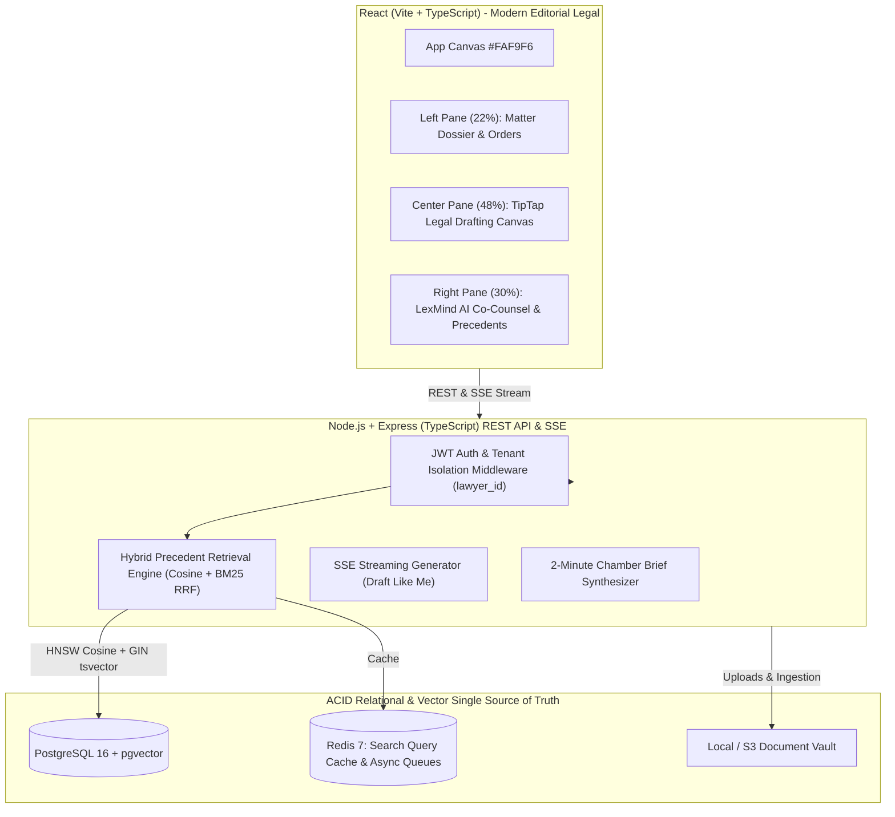

# LexMind (लेक्समाइंड)
**AI-Integrated Legal Case Management System with Personalized Retrieval-Augmented Drafting & Precedent Intelligence**  
*Tailored for Indian Legal Practice (Individual Advocates & Boutique Law Chambers)*

---

## 1. System Vision & Core Differentiator
Unlike generic court-status scrapers (e-Courts/NJDG) or generic legal research portals (SCC Online, Indian Kanoon), **LexMind** grounds generative AI **exclusively in an individual lawyer’s own historical case files, past pleadings, and drafting style**.

### Strict Product Guardrail
> [!IMPORTANT]
> **Zero Predictive Outcome Scoring**: LexMind **NEVER** generates unverified win/loss probability percentages or predictive case outcome scores. All retrieved precedents and generated clauses are strictly grounded in the authenticated lawyer's uploaded documents with explicit inline source citations (e.g., `[Source: Verma v. State, §GROUNDS]`).

---

## 2. Architecture & Tech Stack



* **Frontend:** React 18, Vite, TypeScript, Tailwind CSS, TipTap Editor (`@tiptap/react`), Lucide Icons.
* **Backend:** Node.js, Express.js (TypeScript), Server-Sent Events (SSE).
* **Database & Vector Engine:** **PostgreSQL 16 with `pgvector`** extension (relational metadata, full-text `tsvector`, and 768-dimensional embeddings in one unified ACID datastore).
* **Caching & Queue:** Redis 7 with automatic in-memory fallback.
* **Embeddings & AI:** Gemini Embedding API (`text-embedding-004`, 768 dimensions) & Gemini 2.5/Flash with Zero-Data-Retention headers + high-fidelity offline legal drafting engine.

---

## 3. Database Schema (PostgreSQL + `pgvector`)

1. **`lawyers`**: ID, Full Name, Bar Council ID, Email, Password Hash, Role (`ADVOCATE`, `JUNIOR_ASSOCIATE`, `ADMIN`), `drafting_style_profile` (JSONB).
2. **`cases`**: ID, `lawyer_id` (Indexed FK), Case Title, CNR Number, Client Name, Opposing Party, Court Forum, `case_type` (`CIVIL`, `CRIMINAL`, `WRIT`, `COMMERCIAL`, `FAMILY`, `ARBITRATION`), `status` (`ACTIVE`, `DISPOSED`, `ARCHIVED`), Outcome Summary, Next Hearing Date.
3. **`hearings`**: ID, `case_id`, `lawyer_id`, Hearing Date, Purpose, Judge Coram, Order Summary, Next Action Items.
4. **`documents`**: ID, `case_id`, `lawyer_id`, File Name, File URL, Category (`PETITION`, `WRITTEN_STATEMENT`, `BAIL_APPLICATION`, `COURT_ORDER`, `LEGAL_NOTICE`, `CONTRACT`, `EVIDENCE`), OCR Status, Page Count.
5. **`document_chunks`**: ID, `document_id`, `case_id`, `lawyer_id`, Chunk Index, Section Type (`FACTS`, `GROUNDS`, `PRAYER`, `INDEMNITY`, `ORDER_OPERATIVE_PART`), Content, `search_vector` (`tsvector` via trigger), `embedding` (`vector(768)` with HNSW index), Metadata (JSONB).

---

## 4. Key Features & Workflows

### 1. The 3-Pane Signature Workspace (`/cases/:id`)
* **Left Pane (22% width — Matter Dossier):** Case title, CNR badge, countdown pill to Next Date of Hearing (NDOH), reverse-chronological Hearing Timeline logs, and categorized Case Files tree with upload dropzone.
* **Center Pane (48% width — Drafting Canvas):** TipTap legal rich-text editor with legal formatting toolbar (justified alignment, numbered paragraphs `1. That ...`, heading presets, cause title header, deponent verification affidavit) and **inline Accept / Reject / Diff review** controls.
* **Right Pane (30% width — LexMind Co-Counsel):**
  * *Drafting Assistant:* Intent prompt input with live SSE token streaming, clickable source pills (`[Source: Verma v. State, Bail App.pdf]`), and `< 0.70` similarity fallback threshold guardrail.
  * *Chamber Precedents:* Semantic search bar returning ranked cards with similarity %, outcome badge, highlighted snippet, and slide-over document inspector.

### 2. Hybrid Precedent Retrieval Engine (Module B)
Combines **Cosine Similarity** (`1 - (embedding <=> $1::vector)`) with PostgreSQL **`ts_rank_cd(search_vector, plainto_tsquery('english', $3))`** for exact statutory citations (e.g., *"Section 138 NI Act"*, *"Order 39 Rule 1 & 2 CPC"*, *"Article 226"*), fused via **Reciprocal Rank Fusion (RRF)**:
$$RRF = \frac{1}{60 + \text{rank}_{\text{semantic}}} + \frac{1}{60 + \text{rank}_{\text{lexical}}}$$

### 3. One-Click "2-Minute Chamber Brief" (Hearing Prep)
Synthesizes:
1. Reverse-Chronological Hearing Timeline with Judge Coram & orders
2. Last Operative Court Direction
3. Pending Compliance / Filing Deadlines checklist
4. Recommended Agenda for Next Date of Hearing (NDOH)

---

## 5. Seeded Advocate & Indian Legal Cases

LexMind comes out of the box with realistic Indian legal seed data:

### Seed Advocate Account:
* **Email:** `vikramaditya.sen@delhibar.in`
* **Password:** `advocate123`
* **Bar Council ID:** `D/1429/2011` (Bar Council of Delhi)
* **Chamber:** Lawyers Chambers Block, High Court of Delhi

### Seeded Indian Matters:
1. **Criminal Anticipatory Bail:** `Verma v. State of NCT of Delhi & Anr.` (CNR: `DLHC010045212025`, High Court of Delhi, S. 438 CrPC / 482 BNSS, *Arnesh Kumar* precedent, FIR 88/2025).
2. **Section 138 NI Act Complaint:** `Apex Logistics Pvt. Ltd. v. Rajesh Kumar (Kumar Freightways)` (CNR: `DLSW020089122024`, Patiala House Courts, Cheque Dishonour, Statutory Demand Notice).
3. **Commercial Lease Dispute:** `M/s Heritage Retailers v. DLF Emporium Holdings Ltd.` (CNR: `DLHC010078902024`, High Court of Delhi Commercial Division, Order 39 Rules 1 & 2 CPC, *Gujarat Bottling* three-fold injunction test).
4. **Civil Writ Petition:** `Dr. Anita Rao v. Union of India & AIIMS New Delhi` (CNR: `DLHC010023412025`, High Court of Delhi Writ Jurisdiction, Article 226, arbitrary transfer stay, *Kranti Associates* speaking order doctrine).

---

## 6. Getting Started

### Local Development:
```bash
# 1. Start PostgreSQL (with pgvector) and Redis (e.g. via Docker):
docker compose up -d postgres redis

# 2. Initialize Database & Seed realistic Indian legal dataset:
npm run --prefix server db:init
npm run --prefix server db:seed

# 3. Start Server (Port 5000):
npm run dev:server

# 4. Start Client (Port 3000):
npm run dev:client
```
Open **`http://localhost:3000`** in your browser.
Click **"Use Seeded Advocate Account (Vikramaditya Sen)"** on the login screen to enter the workspace immediately.
